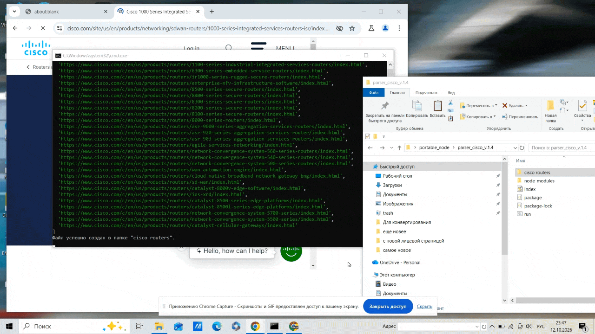

# Cisco Routers Data Sheet Scraper 🕷️📄

An automated **Puppeteer** web scraper designed to extract router product categories from the official Cisco website, discover their technical specifications (Data Sheets), and automatically download/render them as clean PDF documents.

<p align="center">
  
</p>

## 🚀 Features
- **Automated Discovery**: Scans the comprehensive Cisco router portfolio listing.
- **Deep Scraping**: Recursively traverses individual product links to locate official `data sheet` documentation.
- **Clean PDF Generation**: Automatically injects styles to hide intrusive cookie consent banners and live chat widgets before printing, ensuring flawless and distraction-free PDF layouts.
- **Smart File Management**: Auto-generates a clean directory structure using ISO timestamps to keep your downloaded documents perfectly organized without overwriting previous runs.

## 🛠️ Tech Stack
- **Node.js** (Runtime environment)
- **Puppeteer** (Headless Chrome orchestration)
- **Node.js File System** (`fs/promises` for asynchronous I/O)

## 📋 Prerequisites
Before running this project, ensure you have the following installed:
- **Node.js** (v16.0.0 or higher)
- **npm** (comes bundled with Node.js)

## 🔧 Installation & Setup

1. **Clone the repository:**
   ```bash
   git clone https://github.com
   cd cisco-router-scraper
   ```

2. **Install dependencies:**
   ```bash
   npm install
   ```

3. **Run the scraper:**
   ```bash
   npm start
   ```

## 📂 Output Structure
Once execution begins, the script manages directories automatically and generates a `cisco routers/` folder in your project root:
- **Product Categories Log**: A text file listing all scraped router categories (e.g., `Routers_2026-10-12T14-30-00-000Z.txt`).
- **Data Sheets**: Properly formatted PDF files named after their source URL path segments (e.g., `pennultimate-segment-last-segment.pdf`).

## 📝 License
This project is open-source and available under the [MIT License](LICENSE).

